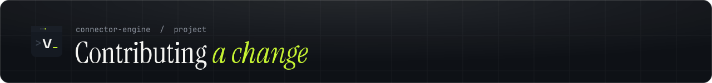

# Contributing

Thanks for helping. This page covers setup, tests, code rules, commits, and the three most common additions: an adapter, an approval surface and a client guide. Read [ARCHITECTURE.md](ARCHITECTURE.md) first.

## Setup

| Tool | Version |
|---|---|
| Go | the version in `go.mod` |
| Node.js | 26 (console web app only) |
| Docker | with Compose 2.20 or newer, for `make up` and the Postgres tests |
| golangci-lint | v2.15.0 |

```sh
git clone https://github.com/versatile-sh/connector-engine
cd connector-engine
go build ./...
```

## Tests

| Command | Runs | Time |
|---|---|---|
| `go test -race -short ./...` | unit and integration tests; skips e2e | about 1 min |
| `go test ./...` | adds the e2e suite on built binaries | a few minutes |
| `CN_EXHAUSTIVE=1 go test ./core/approval ./core/evaluate` | the full model sweeps, which sample by default | about 7 min |
| `cd selfhosted/console/web && npm ci && npm run lint && npm run typecheck && npm test` | the console web app | under 1 min |
| `golangci-lint run` | Go linters | about 1 min |
| `make test` | Go tests, web typecheck, layering check, `adapters check` of both profiles | |
| `make check` | the `person` stack end to end on its own compose project | |

- Postgres tests start a throwaway container and skip without Docker. Set `CN_PG=0` or `CN_DOCKER=0` to skip them on purpose.
- Integration tests remove only what they created, by exact name.
- On a busy machine, limit parallelism: `GOMAXPROCS=4 go test -p 2 ./...`.
- `make seed` serves a throwaway console at `http://127.0.0.1:7477` (`SEED_ADDR=host:port` moves it) with 12 access keys, 15 connectors and 10 skills, to see pages with many items. It takes about nine minutes, prints a one-time `owner` password, keeps everything in memory and a temporary folder, and never touches a running stack or the system keychain. It is `TestSeedPlayground`, skipped unless `CN_SEED_ADDR` is set.

## Code rules

| Rule | Detail |
|---|---|
| No inline comments | Code explains itself through names. Put knowledge that names cannot carry in a godoc or a doc |
| Godoc on every exported symbol | one line, two at most, starting with the symbol's name, kept current with the code |
| Layering | `core/` imports only `port`; no infrastructure type crosses into `port` or `core`; no core package imports `selfhosted/` |
| English identifiers | code, comments, docs and commits are in English |
| No duplication | no copied code and no wrapper that only forwards a call |
| Tests | assert observable behaviour; run with `-race` |
| Formatting | `gofmt` for Go; keep the existing style in the web app (ESLint runs in CI) |

Lint exclusions in `.golangci.yml` are narrow and tied to a path or rule. The main ones:

- `gosec` file and command checks (G204, G304) are off: the engine reads paths and starts processes named by its operator's configuration.
- `gosec` permission checks (G301, G306) are off: `cnctl skills export` writes 0644 files on purpose.
- The console session cookie has no `Secure` flag because the console serves plain HTTP on loopback.
- `errcheck` ignores `fmt.Fprint*` and teardown calls (`Close`, `Stop`, `Serve`).

Add a new exclusion only with the same narrow scope, and explain it in your pull request.

## Commits and pull requests

- One concern per commit. Each commit builds and passes its tests.
- Subject in the imperative, sentence case, no prefix, no trailing period: `Cap the hold window at the approval timeout`.
- The body, when needed, says why.
- Open a pull request against `main`. CI must pass. Fill in the template.

## Add an adapter

An adapter implements one port from `port/ports.go` for one backend.

1. Create the package under the port's directory, for example `source/<name>` for a `ListingSource`. It imports `port` and its own client libraries only.
2. Translate backend errors into `port` error codes at the package edge.
3. Register it in `app.Core()` (`app/core.go`): `Register(r, Sources, Adapter{Name: "<name>", Capabilities: ..., Settings: ...}, open)`. The factory reads its settings from `env.Config` and `env.Setting`, and references with `env.Ref`. Add any new key of `connector-engine.yaml` with its default to `config/`.
4. Nothing else changes: `config` learns the name, capabilities and settings from the registration, and `app/build.go` opens whatever `adapters.yaml` selects.
5. Test it against a local fake or a throwaway container. Stores must pass the shared suite: `storetest.Run`.
6. Run `connector-engine adapters check` on a configuration that selects it.

An adapter only the self-hosted build needs goes under `selfhosted/` and registers in `selfhosted.Register`. An adapter outside this repository is one package with its own `Register(r *app.Registry)` and one line in its own main.

## Add an approval surface

A surface carries an approval prompt to a chat app or device and brings the answer back. Surfaces live in the self-hosted layer.

1. Implement `surface.Channel` (`Kind`, `Notify`, `Settle`, `Listen`) in `selfhosted/surface/<kind>`. Inbound traffic must be outbound from the console (websocket, long polling); open no new listener.
2. Accept clicks only from the configured owner id, and keep call arguments out of third-party messages.
3. Build it from stored settings in `DefaultChannel` (`selfhosted/console/channels.go`).
4. Add its setup steps and fields to `SETUP` in `selfhosted/console/web/src/notifications/setup.ts`, and the new text keys to every dictionary in `src/i18n/`.
5. Test it; the fakes in `selfhosted/surface/relay_test.go` are a model.
6. Update the threat model in `docs/self-hosted/approval-surfaces.md`.

## Add a client guide

A client guide tells a person how to connect one AI app on the console's **Access** page.

1. Add the app's id to `ClientId` in `selfhosted/console/web/src/access/clients.ts`.
2. Add a `Guide` to `oauthGuides`, and to `guides` (access-key setup) for apps that cannot sign in with OAuth: the command, config file or one-click link, built from the endpoint URL passed in.
3. Add its note text to every dictionary in `src/i18n/`.
4. Extend `clients.test.ts` to cover the generated command or config.
5. If the app uses an `https` OAuth redirect, add it exactly to `hostedCallbacks` in `selfhosted/console/oauth.go` and to the redirect cases in `oauth_test.go`; explain why in the pull request.

## Write docs

The user documentation lives in [`docs/`](docs/README.md), one page per task.

- Start each page with its section banner, then a two-line intro.
- Show a command and the output it prints. Copy the output from a real run; never invent a flag.
- Keep one fact in one page and link to it from the others.
- A new page needs a banner: add a line to `SECTIONS` in `docs/assets/src/build-banners.mjs`, then run `npm ci && npm run build` in `docs/assets/src`. The banners and the README flow diagram (`diagram-flow.svg`) are outlined paths and load no font.
- CI checks the docs (`.github/workflows/docs.yml`): relative links and anchors with lychee, then `scripts/check-docs.sh` for the `make` targets and scripts the docs name and the banner sizes.

## Repository layout

| Path | Holds |
|---|---|
| `port/` | neutral types, port interfaces, error codes |
| `core/` | pure rules: catalog visibility, grants, evaluation, approval transitions, pinning, listing checks, projection, names |
| `service/` | use cases and the worker (approval timers, sweeps, re-list, event fan-out) |
| `gateway/` | the agent endpoint `/mcp` |
| `server/` | the operation table and the HTTP, gRPC and management MCP surfaces built from it |
| `runtime/` | `ConnectorRuntime` adapters: `remote` (MCP), `declarative` (REST), `grpc`, `skill`, `memory` |
| `source/` | `ListingSource` adapters: `files`, `openapi`, `reflection`, `bsr`, `registry`, `docker`, `skillcatalog` |
| `store/` | `memory` and `postgres` (row-level security per tenant) |
| `secrets/`, `auth/`, `credential/` | envelope encryption, token verification and the local issuer, the credential broker |
| `filter/`, `index/`, `sink/`, `relay/` | result filter, tool index, event sinks, outbox relay |
| `app/`, `config/` | the composition root and the configuration files |
| `cmd/connector-engine`, `cmd/cnctl` | the headless binaries |
| `internal/plugkit` | in-module copy of the plugin kit (adapters, outbox, discovery) |
| `selfhosted/` | the `person` profile: console, approval surfaces, host keychain, its binaries and compose file ([selfhosted/README.md](selfhosted/README.md)) |
| `deploy/` | `compose.yaml`, the `headless` profile, the shared PaaS image (`deploy/cloud/`) and the community provider templates (`deploy/providers/`) |
| `docs/` | the user documentation and its banners |
| `e2e/`, `scripts/` | end-to-end runs of the built binaries; smoke, e2e, docs checks and the installers |

## Code of conduct

This project follows the [Contributor Covenant](CODE_OF_CONDUCT.md).
