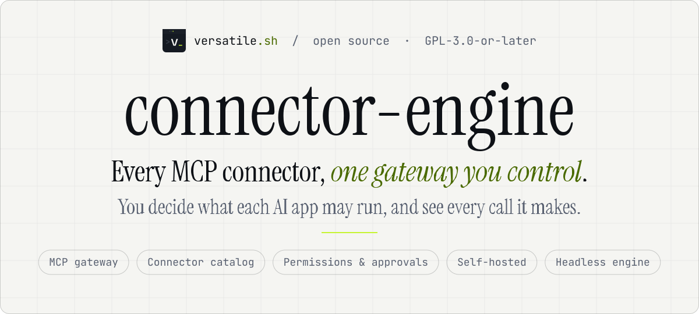
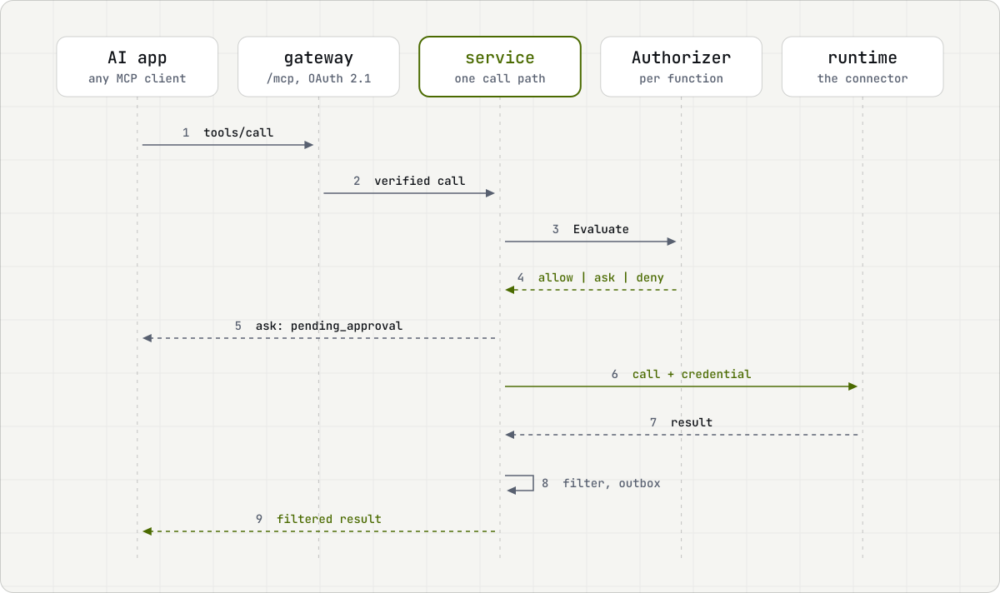
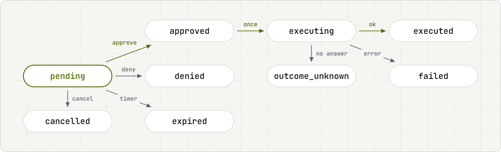

<p align="center">
  <picture>
    <source media="(prefers-color-scheme: dark)" srcset="docs/assets/readme/banner-hero-dark.svg">
    
  </picture>
</p>

<p align="center">
  <a href="https://github.com/versatile-sh/connector-engine/actions/workflows/ci.yml"></a>
  <a href="LICENSE"></a>
  <a href="go.mod"></a>
</p>

<p align="center">
  <b><a href="#install">Install</a></b> &nbsp;·&nbsp;
  <b><a href="#use">Use</a></b> &nbsp;·&nbsp;
  <a href="#how-it-works">How it works</a> &nbsp;·&nbsp;
  <a href="docs/self-hosted/vps.md">VPS</a> &nbsp;·&nbsp;
  <a href="docs/README.md">Docs</a>
</p>

connector-engine sits between your AI apps and the tool servers they call (MCP, REST, gRPC).
You decide, per app and per function, what may run: **off**, **on**, or **ask** a person first.
Every function is pinned by hash, so a tool that changes is held until you accept it.

| For | You get | Start with |
|---|---|---|
| **Individuals** | a local console on `127.0.0.1` that every AI app on your machine signs in to | [Install](#install) |
| **Teams** | one gateway on your own server, behind your identity provider | [Run it on a VPS](docs/self-hosted/vps.md) |
| **Companies and products** | a headless engine you embed: operator API, CloudEvents, your own adapters | [The headless engine](docs/enterprise/headless.md) |

<a id="install"></a>

<picture>
  <source media="(prefers-color-scheme: dark)" srcset="docs/assets/readme/section-install-dark.svg">
  
</picture>

| Platform | Command | |
|---|---|---|
| **Docker** (any OS) | `git clone https://github.com/versatile-sh/connector-engine && cd connector-engine && mise run up` | works today |
| **Linux, macOS** | `curl -fsSL https://raw.githubusercontent.com/versatile-sh/connector-engine/main/scripts/install.sh \| sh`, then `vsh up --open` | after v0.1.0 |
| **Windows** | `irm https://raw.githubusercontent.com/versatile-sh/connector-engine/main/scripts/install.ps1 \| iex` | after v0.1.0 |
| **A VPS** | [Run it on a VPS](docs/self-hosted/vps.md): the binary or Docker on loopback, reached through an SSH tunnel; a small team behind a TLS proxy; or the headless engine behind Caddy | works today with Docker |
| **Docker, no clone** (Linux) | `docker run -d --network host -v connector-engine:/var/lib/connector-engine --entrypoint /usr/local/bin/vsh ghcr.io/versatile-sh/connector-engine:latest up --data /var/lib/connector-engine --no-keychain` | after v0.1.0 |

Works today, with Docker:

```sh
git clone https://github.com/versatile-sh/connector-engine
cd connector-engine
mise run up
```

Without Docker, available after the first release (v0.1.0):

```sh
curl -fsSL https://raw.githubusercontent.com/versatile-sh/connector-engine/main/scripts/install.sh | sh
vsh up --open
```

`mise run up` ends with:

```text
console: http://127.0.0.1:7465   agent endpoint: http://127.0.0.1:7465/mcp
```

Open the console, create your account, import a connector: [First run](docs/getting-started/first-run.md). Your data lives in Docker volumes: export a backup with `mise run export` before any `docker compose down -v` or volume prune. The installers verify the SHA-256 of every download; to read them before running, see [Install](docs/getting-started/install.md#read-it-before-you-run-it).

<a id="use"></a>

<picture>
  <source media="(prefers-color-scheme: dark)" srcset="docs/assets/readme/section-use-dark.svg">
  
</picture>

```sh
claude mcp add --transport http versatile http://127.0.0.1:7465/mcp
codex mcp add versatile --url http://127.0.0.1:7465/mcp
```

Cursor and VS Code have one-click links on the console's **Access** page. Claude Desktop, OpenCode, Antigravity and others get their config on the same page. The app signs in through your browser (OAuth), so there is no key to copy. More in [Connect an AI app](docs/getting-started/connect-an-app.md).

From a terminal, `vsh` does what the console does, as the same user and through the same API:

```sh
vsh login
vsh connectors import --mcp https://mcp.example.com/mcp
vsh access github --kind read on
vsh approvals
```

`vsh` alone opens the same in a full-screen terminal view. Every command is in [the vsh reference](docs/reference/vsh.md).


<a id="how-it-works"></a>

<picture>
  <source media="(prefers-color-scheme: dark)" srcset="docs/assets/readme/section-how-it-works-dark.svg">
  
</picture>

<picture>
  <source media="(prefers-color-scheme: dark)" srcset="docs/assets/readme/diagram-call-dark.svg">
  
</picture>

<picture>
  <source media="(prefers-color-scheme: dark)" srcset="docs/assets/readme/diagram-approval-dark.svg">
  
</picture>

1. An AI app lists and calls tools on one endpoint, `/mcp`.
2. The engine checks the app's permission for that function: off, on, or ask. Off answers like an unknown tool; ask waits for you to approve in the console, a desktop popup or chat.
3. Allowed calls reach the connector, a remote or local MCP server, REST or gRPC, with the stored credential. Each decision and call is recorded and published as an event.

<a id="features"></a>

<picture>
  <source media="(prefers-color-scheme: dark)" srcset="docs/assets/readme/section-features-dark.svg">
  
</picture>

| | | |
|---|---|---|
| **Connector catalog**<br/>Import MCP servers by URL or install link; REST through OpenAPI, gRPC through reflection. | **Per-function permissions**<br/>Off, on or ask for every function, per access key. | **Approvals anywhere**<br/>Answer in the console, a desktop popup, Discord, Slack, Telegram, or the AI app. |
| **Pinned definitions**<br/>A changed tool or a new one is quarantined until you accept it. | **Skills**<br/>Pinned skill packages, granted per key, loaded on demand. | **One-click app sign-in**<br/>OAuth 2.1 with PKCE for every AI app; no keys to paste. |
| **Secrets at rest**<br/>Envelope encryption; root keys wrapped by your OS keychain. | **Activity and events**<br/>Every call on record, redacted; a CloudEvent for every decision. | **Backups**<br/>Encrypted full backups, and shareable setups without credentials. |
| **Headless engine**<br/>No console: your IdP, the operator API, your product decides. | **Adapters**<br/>Postgres, 1Password, webhooks, or your own through one registry. | **Self-hosted**<br/>Runs on your machine or your cloud. Source-available. |

> Never publish the console's port itself. On a server, reach it through an SSH tunnel, or put a TLS reverse proxy in front and set `CONSOLE_PUBLIC_URL` for a small team; the first visitor of a new console becomes its Owner. Products and many users run the headless engine behind TLS and OIDC ([VPS guide](docs/self-hosted/vps.md)).

<a id="docs"></a>

<picture>
  <source media="(prefers-color-scheme: dark)" srcset="docs/assets/readme/section-docs-dark.svg">
  
</picture>

| Read | To |
|---|---|
| [Getting started](docs/README.md#getting-started) | install per OS, first run, connect an app, import a connector |
| [Using it](docs/README.md#using-it) | connectors, permissions, skills, approvals, activity, backups |
| [Self-hosted](docs/README.md#self-hosted) | the person profile, running it on a VPS, the keychain, updating, troubleshooting |
| [Enterprise and headless](docs/README.md#enterprise-and-headless) | OIDC, Postgres, scaling, security model |
| [Reference](docs/README.md#reference) | configuration, `vsh`, API, events |
| [ARCHITECTURE.md](ARCHITECTURE.md) · [CONTRIBUTING.md](CONTRIBUTING.md) · [SECURITY.md](SECURITY.md) | how it is built, how to contribute, how to report a vulnerability |

<a id="other-ways-to-deploy"></a>

<picture>
  <source media="(prefers-color-scheme: dark)" srcset="docs/assets/readme/section-other-ways-to-deploy-dark.svg">
  
</picture>

Community templates for Render, Railway and Fly.io, not tested by maintainers: [`deploy/providers/`](deploy/providers/README.md).

<a id="license"></a>

<picture>
  <source media="(prefers-color-scheme: dark)" srcset="docs/assets/readme/section-license-dark.svg">
  
</picture>

Copyright (C) 2026 Versatile (versatile.sh)

connector-engine is free software: you can redistribute it and/or modify it under the terms of the GNU General Public License as published by the Free Software Foundation, either version 3 of the License, or (at your option) any later version. See [LICENSE](LICENSE). Third-party components keep their own licences, see [NOTICE](NOTICE).

For a commercial licence without the GPL's obligations, contact Versatile through [versatile.sh/contact](https://versatile.sh/contact).

Contributions are accepted under the CLA, see [CONTRIBUTING.md](CONTRIBUTING.md).

Versions published up to and including commit 3858237 (2026-11-20) were released under the MIT License, and later versions before this change under the PolyForm Shield License 1.0.0 with Versatile's additional terms; copies already received keep those terms.
