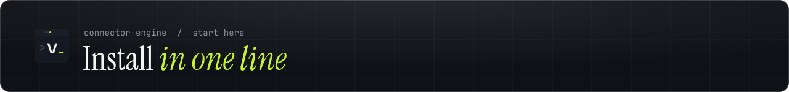
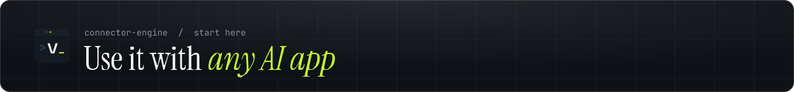
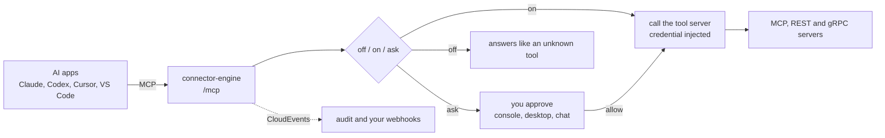
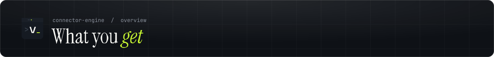
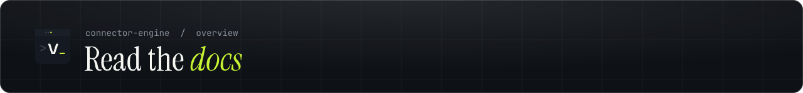

<p align="center">
  
</p>

<p align="center">
  <a href="https://github.com/versatile-sh/connector-engine/actions/workflows/ci.yml"></a>
  <a href="LICENSE"></a>
  <a href="go.mod"></a>
</p>

<p align="center">
  <b><a href="#install">Install</a></b> &nbsp;·&nbsp;
  <b><a href="#use">Use</a></b> &nbsp;·&nbsp;
  <a href="#how-it-works">How it works</a> &nbsp;·&nbsp;
  <a href="#deploy-for-a-team">Deploy</a> &nbsp;·&nbsp;
  <a href="docs/README.md">Docs</a>
</p>

connector-engine sits between your AI apps and the tool servers they call (MCP, REST, gRPC).
You decide, per app and per function, what may run: **off**, **on**, or **ask** a person first.
Every function is pinned by hash, so a tool that changes is held until you accept it.

| For | You get | Start with |
|---|---|---|
| **Individuals** | a local console on `127.0.0.1` that every AI app on your machine signs in to | [Install](#install) |
| **Teams** | one gateway behind your identity provider, with shared connectors and approvals | [Deploy for a team](#deploy-for-a-team) |
| **Companies and products** | a headless engine you embed: operator API, CloudEvents, your own adapters | [The headless engine](docs/enterprise/headless.md) |

<a id="install"></a>



| Platform | Command | |
|---|---|---|
| **Docker** (any OS) | `git clone https://github.com/versatile-sh/connector-engine && cd connector-engine && make up` | works today |
| **Linux, macOS** | `curl -fsSL https://raw.githubusercontent.com/versatile-sh/connector-engine/main/scripts/install.sh \| sh`, then `connector-engine-selfhosted up --open` | after v0.1.0 |
| **Windows** | `irm https://raw.githubusercontent.com/versatile-sh/connector-engine/main/scripts/install.ps1 \| iex` | after v0.1.0 |
| **Docker, no clone** (Linux) | `docker run -d --network host -v connector-engine:/var/lib/connector-engine --entrypoint /usr/local/bin/connector-engine-selfhosted ghcr.io/versatile-sh/connector-engine:latest up --data /var/lib/connector-engine --no-keychain` | after v0.1.0 |

Works today, with Docker:

```sh
git clone https://github.com/versatile-sh/connector-engine
cd connector-engine
make up
```

Without Docker, available after the first release (v0.1.0):

```sh
curl -fsSL https://raw.githubusercontent.com/versatile-sh/connector-engine/main/scripts/install.sh | sh
connector-engine-selfhosted up --open
```

`make up` ends with:

```text
console: http://127.0.0.1:7465   agent endpoint: http://127.0.0.1:7465/mcp
```

Open the console, create your account, import a connector: [First run](docs/getting-started/first-run.md). Your data lives in Docker volumes: export a backup with `make export` before any `docker compose down -v` or volume prune. The installers verify the SHA-256 of every download; to read them before running, see [Install](docs/getting-started/install.md#read-it-before-you-run-it).

<a id="use"></a>



```sh
claude mcp add --transport http versatile http://127.0.0.1:7465/mcp
codex mcp add versatile --url http://127.0.0.1:7465/mcp
```

Cursor and VS Code have one-click links on the console's **Access** page. Claude Desktop, OpenCode, Antigravity and others get their config on the same page. The app signs in through your browser (OAuth), so there is no key to copy. More in [Connect an AI app](docs/getting-started/connect-an-app.md).

<a id="how-it-works"></a>




1. An AI app lists and calls tools on one endpoint, `/mcp`.
2. The engine checks the app's permission for that function: off, on, or ask.
3. Allowed calls reach the tool server with the stored credential. Each decision and call is recorded and published as an event.

<a id="features"></a>



| | | |
|---|---|---|
| **Connector catalog**<br/>Import MCP servers by URL or install link; REST through OpenAPI, gRPC through reflection. | **Per-function permissions**<br/>Off, on or ask for every function, per access key. | **Approvals anywhere**<br/>Answer in the console, a desktop popup, Discord, Slack, Telegram, or the AI app. |
| **Pinned definitions**<br/>A changed tool or a new one is quarantined until you accept it. | **Skills**<br/>Pinned skill packages, granted per key, loaded on demand. | **One-click app sign-in**<br/>OAuth 2.1 with PKCE for every AI app; no keys to paste. |
| **Secrets at rest**<br/>Envelope encryption; root keys wrapped by your OS keychain. | **Activity and events**<br/>Every call on record, redacted; a CloudEvent for every decision. | **Backups**<br/>Encrypted full backups, and shareable setups without credentials. |
| **Headless engine**<br/>No console: your IdP, the operator API, your product decides. | **Adapters**<br/>Postgres, 1Password, webhooks, or your own through one registry. | **Self-hosted**<br/>Runs on your machine or your cloud. MIT licensed. |

<a id="deploy-for-a-team"></a>

## Deploy for a team

The headless engine with Postgres and your OIDC issuer. Fork first and set your issuer; [Deploy to the cloud](docs/enterprise/cloud.md) lists what each platform needs.

[](https://render.com/deploy?repo=https://github.com/versatile-sh/connector-engine)

The button works from the first release on: it builds from the published, public `connector-engine-headless` image.

Fly.io: `fly launch` with [`fly.toml`](fly.toml). Railway: [`railway.json`](railway.json); the template comes with the first release.

> Never expose the person console to the internet: it is a single-owner app for `127.0.0.1`. Teams use the headless engine, which needs an OIDC issuer.

<a id="docs"></a>



| Read | To |
|---|---|
| [Getting started](docs/README.md#getting-started) | install per OS, first run, connect an app, import a connector |
| [Using it](docs/README.md#using-it) | connectors, permissions, skills, approvals, activity, backups |
| [Self-hosted](docs/README.md#self-hosted-the-person-profile) | the person profile, the keychain, updating, troubleshooting |
| [Enterprise and headless](docs/README.md#enterprise-and-headless) | OIDC, Postgres, scaling, security model, cloud deploys |
| [Reference](docs/README.md#reference) | configuration, `cnctl`, API, events |
| [ARCHITECTURE.md](ARCHITECTURE.md) · [CONTRIBUTING.md](CONTRIBUTING.md) · [SECURITY.md](SECURITY.md) | how it is built, how to contribute, how to report a vulnerability |

## License

MIT, see [LICENSE](LICENSE).
