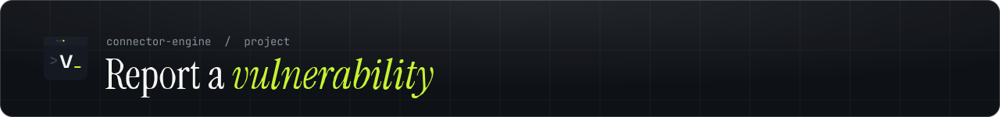

# Security policy

## Report a vulnerability

Report it privately through GitHub: open the repository's **Security** tab and choose **Report a vulnerability**. Do not open a public issue, pull request or discussion.

Include:

- the affected version or commit;
- the profile (`person` or `headless`) and the adapters in use;
- steps to reproduce, or a proof of concept;
- the impact you expect.

We acknowledge a report within 5 working days and agree on a disclosure date with you. Fixes are released before details are published.

## Supported versions

| Version | Supported |
|---|---|
| `main` | yes |

No release is tagged yet. Once releases exist, only the latest minor release receives security fixes until 1.0.

## Threat model

What the engine protects, what it trusts, what is out of scope, and how to deploy it safely: [docs/enterprise/security-model.md](docs/enterprise/security-model.md).

Details:

- [docs/self-hosted/keychain.md](docs/self-hosted/keychain.md): root keys, the host keychain and their threat model.
- [docs/self-hosted/approval-surfaces.md](docs/self-hosted/approval-surfaces.md): approval surfaces and their threat model.
