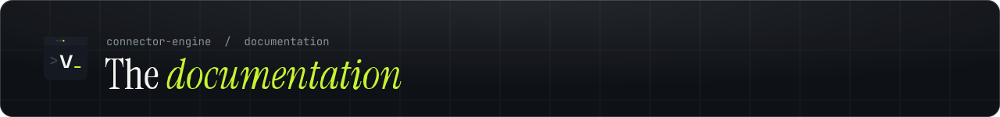

# Documentation

Start with **Install**, then **Use**. Every page is short and has runnable examples.

## Start here

| I want to | Read |
|---|---|
| **install it** on my machine | [Install](getting-started/install.md) |
| **use it** with my AI app | [First run](getting-started/first-run.md), then [Connect an AI app](getting-started/connect-an-app.md) |
| run it on a server | [Run it on a VPS](self-hosted/vps.md) |
| embed it in a product | [The headless engine](enterprise/headless.md) |

## Getting started

| Page | Covers |
|---|---|
| [Install](getting-started/install.md) | Docker, one-line installers per OS, review-before-run, checksums |
| [First run](getting-started/first-run.md) | the owner account, a first connector, a first app |
| [Connect an AI app](getting-started/connect-an-app.md) | Claude Code, Codex, Cursor, VS Code and others; OAuth and access keys |
| [Import a connector](getting-started/import-a-connector.md) | by URL, by install link, what import checks |

## Using it

| Page | Covers |
|---|---|
| [Connectors](using/connectors.md) | kinds, names, pinning and quarantine, prompts and resources |
| [Functions and permissions](using/permissions.md) | off, on, ask; per-key profiles; bulk changes |
| [Skills](using/skills.md) | adding, granting and exporting skills |
| [Approvals and notifications](using/approvals.md) | where you answer: console, desktop, chat apps, the AI app |
| [Activity](using/activity.md) | what is recorded and for how long |
| [Account and backup](using/account-backup.md) | password, full backups, shareable setups, restore |

## Self-hosted

| Page | Covers |
|---|---|
| [The person profile](self-hosted/person.md) | what runs, the no-Docker binary, commands, port, settings |
| [Run it on a VPS](self-hosted/vps.md) | single user over an SSH tunnel, or a team behind Caddy, firewall, backups, updates |
| [The keychain](self-hosted/keychain.md) | root keys, unlock, migration, recovery, 1Password |
| [Updating](self-hosted/updating.md) | update, pin a version, go back |
| [Uninstalling](self-hosted/uninstalling.md) | stop, or delete everything |
| [Troubleshooting](self-hosted/troubleshooting.md) | messages and their fixes |
| [Approval surfaces](self-hosted/approval-surfaces.md) | design record and threat model |

## Enterprise and headless

| Page | Covers |
|---|---|
| [The headless engine](enterprise/headless.md) | profiles, listeners, adapters and the registry |
| [OIDC and tokens](enterprise/oidc.md) | issuers, audiences, claims, roles |
| [Postgres and tenants](enterprise/postgres.md) | the database role, migrations, tenants, retention |
| [Scaling and replicas](enterprise/scaling.md) | one instance, health checks, what replicas need |
| [Security model](enterprise/security-model.md) | what it protects, what it trusts, deploying safely |
| [Deploy to the cloud](enterprise/cloud.md) | community PaaS templates (Render, Railway, Fly.io), not tested by maintainers |
| [Architecture](../ARCHITECTURE.md) | ports and adapters, the path of a call, grants, approvals |

## Reference

| Page | Covers |
|---|---|
| [Configuration](reference/config.md) | both YAML files, references, the keys you change |
| [cnctl](reference/cnctl.md) | every command and group |
| [API](reference/api.md) | HTTP, gRPC and management MCP from one table |
| [Events](reference/events.md) | CloudEvents types and the webhook sink |

## Project

| Page | Covers |
|---|---|
| [Contributing](../CONTRIBUTING.md) | setup, tests, code rules, commits, adding an adapter |
| [Security policy](../SECURITY.md) | reporting a vulnerability |
| [Code of conduct](../CODE_OF_CONDUCT.md) | the Contributor Covenant |
| [Releasing](releasing.md) | for maintainers: publishing a release |
