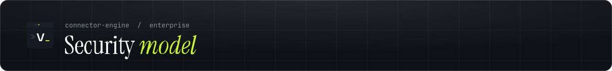

# Security model

The engine is a policy point between AI apps and tool servers. It assumes the agent and the upstream tool server may be hostile, and that the host and its administrator are trusted. To report a vulnerability, see [SECURITY.md](../../SECURITY.md).

## What it protects

| Asset | Protection |
|---|---|
| which functions an agent may call | four grant layers, catalog ceilings, a forced ask for destructive functions and for risky exposure; a denied function looks like an unknown one |
| what a function does | definitions pinned by RFC 8785 hash; a change or a new function is quarantined until a person accepts it |
| approval decisions | an approved call runs once; repeats attach to the same record; chat surfaces accept clicks only from the configured owner id; link tokens are single-use HMACs |
| upstream credentials and console secrets | envelope encryption with a key per tenant; destroying the key shreds the data; secrets are never returned by an API |
| tenant isolation | Postgres row-level security per tenant; a role that bypasses it is refused at boot; the SQLite store of the install without Docker applies the same predicates in every query, checked by the cross-tenant matrix of `store/storetest` |
| the install without Docker | a per-user 0700 data directory owned by its user, a 0600 database, and a control socket (export, import, reset-password) that serves only a peer of the same user |
| the local console | listens on `127.0.0.1` only, with a Host allowlist, Origin checks and CSRF tokens; AI apps sign in with OAuth 2.1 and PKCE S256 |
| call arguments | the engine stores a hash; the console's activity log redacts likely secrets before writing |
| upstream connections | an egress guard refuses private addresses unless `runtime.allowPrivateHosts` is set (`person` sets it, `headless` does not) |

## Out of scope

- A compromised host, root on the host, or anyone with access to the Docker socket.
- A running, unlocked install whose process memory is read.

## Deploying safely

| Rule | Why |
|---|---|
| **Publish the console only on `127.0.0.1`, or behind a TLS reverse proxy with `CONSOLE_PUBLIC_URL` set.** Never publish its port directly | the Host allowlist, `Secure` cookie and OAuth redirects follow `CONSOLE_PUBLIC_URL`; the first visitor of a new console becomes Owner, so claim it before exposing it, or set `CONSOLE_SETUP_TOKEN` so the first screen asks for that secret |
| **Headless needs OIDC.** Configure your issuer before you send traffic | without a trusted issuer, no agent or person token verifies; the local issuer is for dev and the person console only |
| **Keep the operator listener private** | its bearer token can do everything, including snapshots when `server.snapshot` is on |
| **Persist and back up the secrets directory with the database** | rows without the root key cannot be opened; a lost volume loses the data |
| **Run `adapters check` in CI** | production refuses unacknowledged risky settings; see them before deploy, not at boot |

## Details

- [The keychain](../self-hosted/keychain.md): root keys, the host keychain, 1Password, and their threat model.
- [Approval surfaces](../self-hosted/approval-surfaces.md): approval channels and their threat model.
- [ARCHITECTURE.md](../../ARCHITECTURE.md): grants, approvals, pinning.
