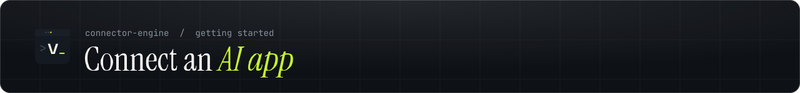

# Connect an AI app

Every AI app talks to one endpoint: `http://127.0.0.1:7465/mcp`. The app signs in through your browser (OAuth 2.1 with PKCE), so there is no key to copy.

## One command

| App | Command or action |
|---|---|
| Claude Code | `claude mcp add --transport http versatile http://127.0.0.1:7465/mcp` |
| Codex | `codex mcp add versatile --url http://127.0.0.1:7465/mcp` |
| Cursor, VS Code | the one-click link on the console's **Access** page |
| Claude Desktop, OpenCode, Antigravity, others | the config shown on the **Access** page for that app |

What happens next:

1. The app registers itself with the console (dynamic client registration).
2. Your browser opens the console. Sign in and allow the app once.
3. The app gets a token for one hour and a refresh token. It refreshes by itself.

Allowing an app creates an **access key** named after it. Grants, the key list and **Revoke** work on it like on any key.

## Apps without OAuth

Scripts, `vsh` and apps that cannot sign in use an access key made on the **Access** page. The page shows the exact command or config for each client.

```sh
export CN_AGENT_TOKEN=<the access key>
mise run cli -- tools list
```

```text
<n> tools: <alias>__<function>, ...
full definitions in /tmp/vsh-tools-<random>.json
```

`mise run cli` runs `vsh` from the image against `http://127.0.0.1:7465/mcp` and prints a summary of the functions this key may call. With `vsh` on your PATH, set `CN_ENDPOINT` and run `vsh tools list`. See [vsh](../reference/vsh.md).

## Endpoints the app uses

| Endpoint | Role |
|---|---|
| `/.well-known/oauth-protected-resource[/mcp]` | names the console as the authorization server |
| `/.well-known/oauth-authorization-server` | describes it |
| `/oauth/register` | dynamic client registration (RFC 7591) |
| `/oauth/authorize` | PKCE S256 only |
| `/oauth/token` | `authorization_code` and rotating `refresh_token` |

- Accepted redirects: loopback `http` on any port, and app schemes such as `cursor:` or `vscode:`. The only `https` redirect is Antigravity's own `https://antigravity.google/oauth-callback`, listed exactly; the code is useless without the app's PKCE verifier.
- Access tokens are engine agent tokens that live one hour. The console keeps registered clients and the SHA-256 of refresh tokens (90 days) in its state file.
- Opening `/mcp` in a browser leads to the **Access** page.

Next: [import a connector](import-a-connector.md).
