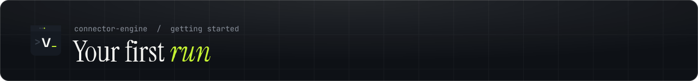

# First run

Five steps from a running stack to an AI app calling a tool you allowed. It assumes you ran [`mise run up`](install.md#docker-from-a-clone).

## 1. Open the console

Open `http://127.0.0.1:7465` (or the `CONSOLE_PORT` you chose). The console listens on `127.0.0.1` only.

## 2. Create the owner account

The first screen asks for a username and a password. It becomes the Owner, and whoever reaches a new console first creates it, so open it before anyone else can (on a shared address, set `CONSOLE_SETUP_TOKEN` and the screen asks for it). Add other people later from Account, People ([roles](../self-hosted/person.md#roles-and-ownership)).

Have a backup from another machine? Choose **Restore from a backup** on the same screen instead ([account and backup](../using/account-backup.md#restore)).

## 3. Import a connector

After you sign in, the **Dashboard** opens with a short checklist (the account, a first connector, a first AI app) that ticks itself and hides when all three are done. Open **Connectors** in the sidebar and paste the URL of an MCP server, or open an install link. Review its functions, then confirm. See [import a connector](import-a-connector.md).

## 4. Choose what may run

Each function is **off**, **on**, or **ask** (hold the call until you decide). The import proposes a choice per function; change any of them. See [functions and permissions](../using/permissions.md).

## 5. Connect an AI app

```sh
claude mcp add --transport http versatile http://127.0.0.1:7465/mcp
```

The app opens the console in your browser; you allow it once. See [connect an AI app](connect-an-app.md).

## Check it works

```sh
mise run ps
```

Expected: `postgres`, `engine` and `console` are listed as running (`Up`).

After a reboot or a container restart, the engine waits for its unlock key. Run:

```sh
mise run unlock
```

See [the keychain](../self-hosted/keychain.md) for why, and [troubleshooting](../self-hosted/troubleshooting.md) if a step fails.
