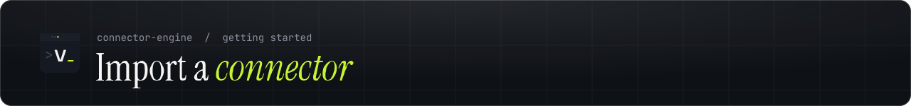

# Import a connector

A connector is a tool server (MCP, REST or gRPC) the engine calls on behalf of your AI apps. You import it once; every access key then gets the functions you allow.

## From a URL

1. Open **Connectors** in the console.
2. Paste the `https` URL of an MCP server.
3. Review the functions and the proposed choice for each: off, on or ask.
4. Confirm. Sign in to the provider if it asks.

Nothing is installed before you confirm.

## From an install link

A link opens the same review, after sign-in. Directories such as the versatile.sh connector directory use them.

| Link | Opens |
|---|---|
| `http://127.0.0.1:7465/import?mcp=<https MCP URL>` | a review of an MCP server |
| `http://127.0.0.1:7465/import?listing=<https URL of a listing>` | a review of a listing in the Manifest format |
| `http://127.0.0.1:7465/import?listing=<https URL of a skill catalog entry>` | a review of a skill (`kind: skill`) |

The page shows the origin, title, icon, publisher and version (a skill's licence and short commit), the review, who may load it, the notice that nothing is installed yet, and the **Add** button. On a wide screen the page is two columns: the title, icon and facts on the left, and on the right one card that holds the review, who may load it and the notice, with **Add** at its foot. The card is as tall as its content and never scrolls inside itself; a connector with a very long list of functions makes the page scroll and keeps **Add** in view at the bottom of the window. On a narrow screen the page is one column and the **Add** button is in a bar at the bottom of the page.

## What the engine does on import

- It captures every function and pins it by an RFC 8785 hash.
- A function that changes later, or a new one, is **quarantined** until you accept it. See [connectors](../using/connectors.md#pinning-and-quarantine).
- Upstream connections refuse private addresses unless the profile allows them. The `person` profile does, so a server on `localhost` works: the engine dials `host.docker.internal` in its place.

## From a backup or a shared setup

A setup file from a friend or a teammate adds its connectors and skills through this same import. See [export and import](../using/account-backup.md#export-and-import).

Next: [functions and permissions](../using/permissions.md).
