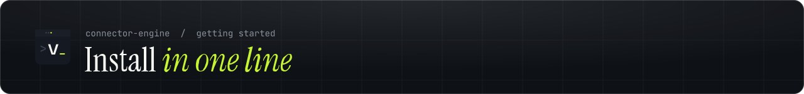

# Install

Pick the line for your machine. Each option installs the `person` profile: the engine, the local console and `cnctl`, for one person on their own computer. For a team or a product, see [the headless engine](../enterprise/headless.md) and [cloud deploys](../enterprise/cloud.md).

| You have | Run | Status |
|---|---|---|
| Docker and Git | [Docker, from a clone](#docker-from-a-clone) | works today |
| Linux or macOS, no Docker | [`install.sh`](#linux-and-macos) | from the next release |
| Windows, no Docker | [`install.ps1`](#windows) | from the next release |
| Docker, no clone | [`docker run`](#docker-without-a-clone) | from the next release |

"From the next release" means the option needs a published release and the no-Docker runtime: one binary, `connector-engine-selfhosted`, that runs the engine and the console in one process over an embedded SQLite store, with the root keys in your OS keychain. Until it ships, use Docker from a clone. Daily use without Docker: [the person profile](../self-hosted/person.md#without-docker).

## Docker, from a clone

Needs Docker with Compose 2.20 or newer, Git and Make. Go on the host is optional: with it, `make up` also stores the unlock key in your OS keychain ([keychain](../self-hosted/keychain.md)).

```sh
git clone https://github.com/versatile-sh/connector-engine
cd connector-engine
make up
```

The last line of the output:

```text
console: http://127.0.0.1:7465   agent endpoint: http://127.0.0.1:7465/mcp
```

Port 7465 taken? Run `make up CONSOLE_PORT=9123`. Next: [first run](first-run.md).

## Linux and macOS

From the next release.

```sh
curl -fsSL https://raw.githubusercontent.com/versatile-sh/connector-engine/main/scripts/install.sh | sh
```

What it prints:

```text
Downloading connector-engine_linux_amd64.tar.gz (latest) from https://github.com/versatile-sh/connector-engine/releases/latest/download
Verified SHA-256 3f1c…
Installed /home/you/.local/bin/connector-engine-selfhosted
Installed /home/you/.local/bin/connector-console
Installed /home/you/.local/bin/cnctl

Next step: start it; it opens the console in your browser.
  connector-engine-selfhosted up --open
```

The script:

1. picks the archive for your system and architecture (`amd64` or `arm64`);
2. downloads it and `checksums.txt` from the GitHub release;
3. stops without installing anything when the SHA-256 does not match;
4. copies the binaries to `~/.local/bin` and prints the next step.

| Variable | Default | Sets |
|---|---|---|
| `CONNECTOR_ENGINE_VERSION` | `latest` | a release tag, such as `v0.1.0` |
| `CONNECTOR_ENGINE_PROFILE` | `person` | `headless` installs `connector-engine` and the core `cnctl` instead |
| `CONNECTOR_ENGINE_INSTALL_DIR` | `$HOME/.local/bin` | where the binaries go |
| `CONNECTOR_ENGINE_BASE_URL` | the GitHub release | another place holding the same files, such as a mirror |

### Read it before you run it

Piping a script into `sh` runs code you have not read. To review it first:

```sh
curl -fsSLO https://raw.githubusercontent.com/versatile-sh/connector-engine/main/scripts/install.sh
less install.sh
sh install.sh
```

Or skip the script: download the archive and `checksums.txt` from the [releases page](https://github.com/versatile-sh/connector-engine/releases), then check it yourself.

```sh
sha256sum --ignore-missing -c checksums.txt     # macOS: shasum -a 256 --ignore-missing -c checksums.txt
```

```text
connector-engine_linux_amd64.tar.gz: OK
```

Each archive also has an SPDX SBOM next to it (`<archive>.sbom.json`).

## Windows

From the next release. In PowerShell:

```powershell
irm https://raw.githubusercontent.com/versatile-sh/connector-engine/main/scripts/install.ps1 | iex
```

It does the same steps as `install.sh`, verifies with `Get-FileHash`, installs to `%LOCALAPPDATA%\connector-engine\bin` and reads the same variables. To review it first:

```powershell
irm https://raw.githubusercontent.com/versatile-sh/connector-engine/main/scripts/install.ps1 -OutFile install.ps1
notepad install.ps1
powershell -ExecutionPolicy Bypass -File .\install.ps1
```

## Docker without a clone

From the next release, and Linux only: it runs the no-Docker runtime inside the published image. That runtime listens on `127.0.0.1` only, so the container shares the host's network instead of publishing a port.

```sh
docker run -d --name connector-engine --network host --restart unless-stopped \
  -v connector-engine:/var/lib/connector-engine \
  --entrypoint /usr/local/bin/connector-engine-selfhosted \
  ghcr.io/versatile-sh/connector-engine:latest up --data /var/lib/connector-engine --no-keychain
```

- The console is then at `http://127.0.0.1:7465`, for this machine only; see [security model](../enterprise/security-model.md).
- A container cannot reach your OS keychain (`--no-keychain`), so the root key rests in plaintext in the volume. Treat the volume like a password store.
- On macOS and Windows, use Docker from a clone or the installers.

## Images and archives

| Artifact | For |
|---|---|
| `ghcr.io/versatile-sh/connector-engine` | the full image: engine, self-hosted engine, console, `cnctl` |
| `ghcr.io/versatile-sh/connector-engine-headless` | the headless image: engine and core `cnctl` only |
| `connector-engine_<os>_<arch>` | `connector-engine-selfhosted`, `connector-console`, `cnctl` |
| `connector-engine-headless_<os>_<arch>` | `connector-engine`, core `cnctl` |

Both images are built for `linux/amd64` and `linux/arm64`. Archives exist for Linux, macOS and Windows on `amd64` and `arm64`.
