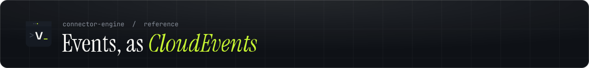

# Events

Every decision and every call is published as a [CloudEvent](https://cloudevents.io). An event is written to the outbox in the same transaction as the change it describes, then delivered to the sinks in order, at least once. Deduplicate by `id`.

## Receive them

```yaml
# adapters.yaml
ports:
  sink: {use: builtin:webhook, config: {url: "https://hooks.mycompany.com/connector-engine", secretRef: "env:CN_SINK_SECRET"}}
```

The `webhook` sink signs each request with [Standard Webhooks](https://www.standardwebhooks.com) signatures under `secretRef`; verify them before you trust a payload. The `log` sink writes events to the engine's log instead.

## Envelope

| Attribute | Value |
|---|---|
| `type` | one of the types below, such as `connector.call.finished` |
| `source` | `connector-engine/<tenant>`, or `connector-engine/installation` |
| `subject` | the object the event is about, such as an approval or a connector id |
| `tenant`, `workspace` | extension attributes, always present |

Each type's JSON Schema has the `$id` `https://agents-control.dev/connector-engine/events/v1/<type>`. These URIs are stable wire identifiers.

## Types

| Area | Types |
|---|---|
| calls | `connector.call.started`, `finished`, `failed`, `denied`, `outcome_unknown` |
| approvals | `connector.approval.requested`, `decided`, `expired`, `cancelled`, `brake`, `brake_cleared` |
| connectors | `connector.connector.installed`, `updated`, `removed`, `instructions_changed`, `enabled_changed`, `blocked_changed` |
| functions | `connector.function.quarantined`, `accepted`, `removed` |
| grants and bindings | `connector.grant.created`, `revoked`, `expired`, `confirmed`, `connector.binding.changed` |
| exposure | `connector.agent.exposure_warning` |
| credentials | `connector.credential.connected`, `needs_reauth`, `revoked` |
| catalog and listings | `connector.listing.imported`, `reviewed`, `created`, `status_changed`, `connector.catalog.rule_changed`, `policy_changed`, `offer_changed` |
| tenants | `connector.tenant.created`, `removed` |
| overlays | `connector.overlay.changed`, `suggested` |

The engine also consumes three outside facts: `session.ended`, `agent.removed`, `person.removed`.

**Source of truth:** [`catalog/catalog.go`](../../catalog/catalog.go). Each type has a JSON Schema; ask the engine for it:

```sh
curl -s http://127.0.0.1:8080/v1/event-types/connector.call.finished
```

```text
{"number":20,"name":"connector.call.finished","consumed":false,"schema":{"$id":"https://agents-control.dev/connector-engine/events/v1/connector.call.finished","$schema":"https://json-schema.org/draft/2020-12/schema",...}}
```

`vsh admin events list` prints every type the same way.
