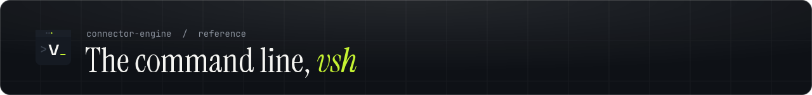

# vsh

`vsh` is the command line of connector-engine. It drives the operator and management API over HTTP, and acts as one agent over MCP.

```text
vsh admin [--url URL] [--token TOKEN] <group> <verb> [path values] [--field value] [--json BODY]
vsh admin call <operationId> [path values] [--json BODY]
vsh tools list [--out FILE]
vsh tools search QUERY [--limit N] [--out FILE]
vsh tools call NAME [--args JSON] [--fields /a,/b] [--out FILE]
vsh skills export --to DIR [--skill NAME] [--prune]
```

The self-hosted build (`selfhosted/cmd/vsh`, the one binary of the `person` archive, also in the image) adds:

```text
vsh up [--open] [--port N] [--data DIR] [--no-keychain]
vsh stop | status [--data DIR]
vsh export [--setup] [--out FILE] [--yes] | import FILE [--yes]
vsh reset-password [--user NAME]
vsh uninstall --keep-data | --purge [--yes] [--no-keychain]
vsh keychain get|ensure|import|delete [--name NAME]
vsh notify [--console URL] [--key-file FILE]
```

The headless archive ships a core-only `vsh` (admin, tools, skills) with no self-hosted code, next to the `connector-engine` engine.

## Help and exit codes

`vsh --help`, `vsh <command> --help` and `vsh <command> <subcommand> --help` print one format: a `Usage:` line, a sentence, and the commands or flags. Flags may come before, between or after the arguments; `--` ends them. An error prints `vsh: <what went wrong>` and, when there is one, `next: <what to run>`.

| Code | Meaning |
|---|---|
| 0 | done |
| 1 | the command failed |
| 2 | wrong usage: an unknown command, flag or argument |
| 3 | nothing to talk to: no install runs on the data directory, or no OS keychain for `vsh keychain` |

## Lifecycle without Docker

`vsh up` runs the engine and the console in its own process, in the foreground, with a control socket in the data directory that `stop`, `status`, `export`, `import`, `reset-password` and `uninstall` talk to. See [the person profile](../self-hosted/person.md#without-docker).

## admin

Reads `VSH_ADMIN_URL` and `VSH_ADMIN_TOKEN`, or `--url` and `--token`. The operator listener and token run installation-wide operations (tenants, adapters, event types); tenant data (connectors, grants, approvals, calls, roles) needs the public listener and a person token whose role allows it, or the answer is `403 permission_denied: <who> may not <permission> on <scope>`.

```sh
export VSH_ADMIN_URL=http://127.0.0.1:8081 VSH_ADMIN_TOKEN=dev
vsh admin tenants create t1
```

```text
{
  "id": "t1",
  "state": "active",
  "key_ref": "local:t1:1",
  "created_by": "system",
  "created_at": "2026-11-20T21:09:45.216608135Z"
}
```

| Group | Verbs |
|---|---|
| `listings` | `list get create lint review quarantine deprecate withdraw restore offered starter` |
| `sources` | `sync list` |
| `calls` | `list` |
| `secrets` | `rotate` |
| `issuers` | `client` |
| `connectors` | `list get install enable disable update level remove` |
| `functions` | `list accept classify enable disable projection` |
| `bindings` | `list put delete level` |
| `grants` | `list create delete confirm` |
| `approvals` | `list get decide cancel` |
| `overlays` | `list suggest propose accept restore clear` |
| `tenants` | `create remove` |
| `roles` | `list put delete` |
| `groups` | `list put delete` |
| `operations` | `get` |
| `adapters` | `list` |
| `events` | `list get` |

`vsh admin --help` prints this list from the binary. `call <operationId>` reaches every operation of the [API](api.md), including those without a group.

In the `person` profile, `make admin ARGS="tenants create t2"` runs it from the image with the generated operator token.

## tools

Reads `CN_ENDPOINT` (the `/mcp` address) and `CN_AGENT_TOKEN` (an access key or agent token). An MCP client for one agent.

```sh
export CN_ENDPOINT=http://127.0.0.1:7465/mcp CN_AGENT_TOKEN=<access key>
vsh tools search "create issue" --limit 3
vsh tools call github__create_issue --args '{"title":"Hello"}' --out result.json
```

- It writes the full answer to `--out` and prints a summary.
- A held call prints its `approval_id`; poll it with `vsh tools call approval_status --args '{"approval_id":"<id>"}'`.
- In the `person` profile, `make cli ARGS="tools list"` runs it from the image.

## skills export

Writes every skill granted to the agent into `DIR/<skill>/`. See [skills](../using/skills.md#export-skills-to-an-apps-folder).

## keychain and notify

| Command | Does |
|---|---|
| `vsh keychain ensure --name connector-engine` | creates the unlock key in the OS keychain if missing |
| `vsh keychain get --name connector-engine` | prints it (used by `make unlock` on a pipe) |
| `vsh keychain import --name connector-engine` | reads it on stdin |
| `vsh keychain delete --name connector-engine` | removes it |
| `vsh notify` | desktop popups for calls waiting for approval (`make notify`) |

`--name` is the compose project (`PROJECT`, default `connector-engine`). See [the keychain](../self-hosted/keychain.md).
