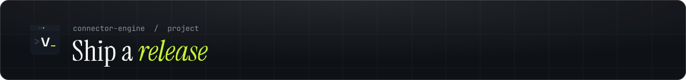

# Releasing

For maintainers. A release is one tag push: GitHub Actions builds every artifact from that commit and publishes them together.

## Rehearse

Run the **Release** workflow by hand (Actions → Release → Run workflow). It builds a snapshot and publishes nothing: binaries, checksums and SBOMs are attached to the run as the `snapshot` artifact, and the images are built without being pushed.

Locally, with the same pinned GoReleaser:

```sh
go run github.com/goreleaser/goreleaser/v2@v2.20.3 check
go run github.com/goreleaser/goreleaser/v2@v2.20.3 release --snapshot --clean --skip=sbom
```

```text
  • 1 configuration file(s) validated
  ...
  • release succeeded after 1m57s
```

Then try the installer against the output:

```sh
CONNECTOR_ENGINE_BASE_URL=file://$PWD/dist CONNECTOR_ENGINE_INSTALL_DIR=/tmp/ce-bin sh scripts/install.sh
```

## Before the first tag

- Merge `feat/no-docker` first. The installers, the docs and the `docker run` line start the install with `connector-engine-selfhosted up`, which only that branch adds. A tag cut before it ships binaries without `up`.
- The workflow must be on `main` before it can be run by hand: rehearse after this change merges.

## Publish

```sh
git tag -a v0.1.0 -m v0.1.0
git push origin v0.1.0
```

The **Release** workflow then:

| Job | Publishes |
|---|---|
| Binaries, checksums and SBOMs | a GitHub release with `connector-engine_<os>_<arch>` and `connector-engine-headless_<os>_<arch>` archives (Linux, macOS, Windows; amd64, arm64), `checksums.txt`, one SPDX SBOM per archive, `install.sh` and `install.ps1` |
| Container image (connector-engine) | `ghcr.io/versatile-sh/connector-engine:<version>`, `:<major>.<minor>`, `:latest` |
| Container image (connector-engine-headless) | `ghcr.io/versatile-sh/connector-engine-headless`, same tags |

Images are multi-arch (`linux/amd64`, `linux/arm64`) with an SBOM and provenance attestation. A tag with a hyphen (`v0.2.0-rc.1`) is a pre-release and does not move `latest`.

## Once, after the first release

| Step | Why |
|---|---|
| set both GHCR packages to public (package settings → visibility) | `docker run` and `deploy/cloud/Dockerfile` pull without credentials |
| update [SECURITY.md](../SECURITY.md) "Supported versions" | it says no release is tagged yet |
