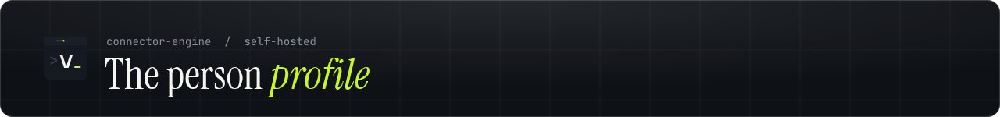

# The person profile

The `person` profile runs connector-engine for one person on their own machine. It adds a local web console, which is also the OAuth server for your AI apps, approval surfaces, and a keychain for the root keys.

## What runs

| Service | Image entrypoint | Does |
|---|---|---|
| `init` | `connector-engine init` | writes the operator token and the Postgres passwords once, then exits |
| `postgres` | `postgres:16-alpine` | the engine's database |
| `engine` | `connector-engine-selfhosted` | the engine with the `hostkey` secrets adapter |
| `console` | `connector-console serve` | the web console on `127.0.0.1:<CONSOLE_PORT>` |

Only the console port is published, on `127.0.0.1`. The compose project is `connector-engine`; `PROJECT=<name>` with its own `CONSOLE_PORT` runs a second, separate install.

## Commands

| Command | What it does |
|---|---|
| `make up` / `make down` / `make logs` / `make ps` | start, stop, follow, list the stack |
| `make unlock` | deliver the unlock key from the host keychain after a restart |
| `make notify` | desktop popups for calls waiting for approval |
| `make export` / `make import FILE=...` | full backup or shareable setup, and restore ([account and backup](../using/account-backup.md)) |
| `make reset-password` | set a new console password from this machine, even for the last Owner; `USER=<username>` names whose once there are several users |
| `vsh login`, then `vsh connectors`, `vsh access`, `vsh approvals`, … | manage the install from a terminal as a signed-in user, with or without Docker ([vsh](../reference/vsh.md#sign-in-and-manage)) |
| `make cli ARGS="tools list"` | `vsh` from the image against the console's `/mcp`; set `CN_AGENT_TOKEN` |
| `make admin ARGS="tenants create t2"` | `vsh admin` against the operator listener with the generated operator token |
| `make keychain-status` / `keychain-migrate` / `keychain-revert` | report, move a plaintext root key under the keychain, or back ([keychain](keychain.md)) |
| `make keychain-recovery` / `keychain-import` | print the unlock key for a password manager, or restore it from stdin |

## Without Docker

One binary, `vsh`, runs the engine and the console in one process on `127.0.0.1`, over an embedded SQLite store. It needs no Docker, no Postgres and no Go. The installers that put it on your machine are available after the first release (v0.1.0); until then, [build it from source](../../selfhosted/README.md#build).

```sh
vsh up --open
```

| Command | Flags | Does |
|---|---|---|
| `up` | `--data DIR`, `--port 7465`, `--open`, `--no-keychain` | runs in the foreground until Ctrl-C, `stop` or SIGTERM; prints the console URL and the agent endpoint (`<console>/mcp`) |
| `stop` | `--data DIR` | asks the running install to stop and waits |
| `status` | `--data DIR` | prints the pid, version, console URL and data directory; exits 3 when nothing runs |
| `export` | `--data DIR`, `--out FILE`, `--setup`, `--yes` | a full encrypted backup (`.cebak`, asks a passphrase twice), or a shareable setup with `--setup`; the default file is dated, in `$BACKUP_DIR` or `~/connector-engine-backups` |
| `import FILE` | `--data DIR`, `--yes` | shows what the file holds, asks, then restores it; a full backup replaces everything and restarts the engine and the console on the restored data |
| `reset-password` | `--data DIR`, `--user NAME` | sets a new console password for the named user, or the only one, and signs that user's sessions out |
| `uninstall` | `--data DIR`, `--keep-data` or `--purge`, `--yes`, `--no-keychain` | stops the install; `--purge` also deletes the data directory and the unlock key, but only a real directory (not a symlink) whose entries are all part of an install (`.DS_Store` and `desktop.ini` aside) |

`export`, `import` and `reset-password` reach the running process through its control socket, so the install must be up.

### Data directory

`--data`, else `$CN_DATA_DIR`, else:

| OS | Default |
|---|---|
| Linux and the BSDs | `$XDG_DATA_HOME/connector-engine`, else `~/.local/share/connector-engine` |
| macOS | `~/Library/Application Support/connector-engine` |
| Windows | `%AppData%\connector-engine` |

It is created with mode 0700, and `up` refuses one that group or others can open or that another user owns.

| Path | Holds |
|---|---|
| `engine/store.db` (and `-wal`, `-shm`) | the engine's database, mode 0600: SQLite in WAL mode, `synchronous=FULL`, a 5 s busy timeout |
| `engine/secrets/` | the engine's key store: the root key, the key ring and the local issuer's signing keys |
| `console/` | the owner account, access keys and agents, OAuth clients, activity, settings, and the console's key store in `console/secrets/` |
| `operator-token` | the token the console uses on the engine's operator listener, mode 0600 |
| `control.sock` | the control socket of the running process, mode 0600; it serves only a peer of the same user (`SO_PEERCRED` on Linux, `LOCAL_PEERCRED` on macOS) and refuses a second `up` on the same directory. Windows has no peer credentials on AF_UNIX: the socket rests on the ACL of the data directory, private under `%AppData%`; keep a `CN_DATA_DIR` there private too |

### Network and keychain

- The console listens on `127.0.0.1:7465` (`--port`). The engine's listeners take free ports on `127.0.0.1`; nothing listens on another interface.
- The settings are those of the person profile, with the listeners on the loopback, the key stores in the data directory, no unlock socket and no `host.docker.internal`.
- The unlock key is read from the OS keychain at start: no `make unlock`, no locked state after a restart. Its account is `local-` and 12 hex digits of the data directory's hash, so it never meets a Docker install's item ([keychain](keychain.md#without-docker)).
- Without a keychain (or with `--no-keychain`) the root keys stay plaintext files and the console warns; a wrapped root key never falls back to plaintext, and a missing keychain item for a wrapped root key stops the start instead of minting a new key.

### Move a Docker install here

1. On the Docker install: `make export`. Keep the `.cebak` file and its passphrase.
2. `make down`: both installs use port 7465, and `down` keeps the Docker volumes.
3. `vsh up`.
4. In another terminal: `vsh import ~/connector-engine-backups/connector-engine-backup-<stamp>.cebak`, and type the passphrase.

The root keys are wrapped again by this machine's keychain, and the access keys your apps already hold keep working. The way back (SQLite to Postgres) is not supported yet.

### Run it as a service

`up` stays in the foreground and stops cleanly on SIGTERM. Point a systemd user unit (`ExecStart=/path/to/vsh up`, `Restart=on-failure`), a launchd agent (`ProgramArguments` with `up`, `KeepAlive`) or a Windows scheduled task at logon at it.

## Port and host

- `CONSOLE_PORT` (default 7465) is the only port setting. Put `CONSOLE_PORT=9123` in `selfhosted/deploy/.env` to keep it.
- It sets the published port, the Host allowlist (`127.0.0.1`, `localhost` and `[::1]` at that port) and the OAuth redirect `http://127.0.0.1:<port>/oauth/callback`.

Outside Docker, run the console against an engine you started yourself, with `connector-console` built from source (`go build ./selfhosted/cmd/connector-console`):

```sh
connector-console --listen 127.0.0.1:7465 --engine http://127.0.0.1:8080 \
  --engine-operator http://127.0.0.1:8081 --operator-token-file <file> --state <file>
```

`connector-console --help` lists every flag.

## Engine identity

The console acts on the engine as engine persons, never as one shared account:

| Flag (env) | Default | Is |
|---|---|---|
| `--person` (`CONSOLE_PERSON`) | `owner` | the first Owner's person; agent tokens made before multi-user name it, so they keep working |
| `--service-person` (`CONSOLE_SERVICE_PERSON`) | `console` | the person the console reads as and writes role rows as; it must be the `tenant_admin` row of `bootstrap.roles` |
| `--managers-group` (`CONSOLE_MANAGERS_GROUP`) | `managers` | the engine group that holds every Owner and Admin |

- Every write runs as the person of the console user who made it, so the engine's audit, `decided_by` on approvals and the grants name that user. A write with no user behind it is refused before it reaches the engine.
- Background writes act for the key's owner: a refresh-token renewal and a decision from an app's elicitation. A decision from a chat channel or a desktop link acts as the user who added the channel or paired the computer; the engine refuses it when that user is not an approver of the call. "Always allow" acts as the user who chose it.
- Each notification channel and paired computer belongs to the user who added it; those from an earlier console belong to the first Owner. The approvals watch notifies only the channels and computers of the key's owner (the call's `on_behalf_of`).
- Reads and the approvals watch run as the service person; the console then shows each user what is theirs.
- At every start, and after a restore, the console writes each user's engine role as the service person: `tenant_admin` over `t/<tenant>` for an Owner or Admin, `agent_configurer` over `t/<tenant>/w/<workspace>` for a Member, and membership of the managers group for Owners and Admins. It removes the rows of its users that should not be there and the old `owner` row once no user is `owner`; rows of other persons stay.
- Upgrading with your own `connector-engine.yaml`: add the service person's row to `bootstrap.roles`, or the console logs "waiting for the engine" and every page stays empty. The old `owner` row can stay; the console then manages it.
- Each access key has one owner, the user who made it; its agent tokens and bindings carry that person as `on_behalf_of` and `agent_owner`. Keys from an earlier console belong to the first Owner. A key name another user's key has is refused with "this name is taken".

## Roles and ownership

Each console user has a role: Owner, Admin or Member. Every console route declares one capability, and a role either holds it or gets `403` with `code: forbidden`. A route that declares none is refused for everyone.

| Capability | Owner | Admin | Member |
|---|---|---|---|
| `people.manage`, `backup.full`, `activity.delete` | yes | | |
| `people.read`, `people.reset`, `connectors.manage`, `skills.manage`, `setup.manage`, `activity.settings` | yes | yes | |
| `keys.any`, `approvals.any`, `activity.any` | yes | yes | |
| `keys.own`, `approvals.own`, `activity.own`, `notifications.own`, `signin.own`, `account.own` | yes | yes | yes |

- `GET /api/session` returns the signed-in `user` (`person`, `username`, `role`), the capabilities they hold as `can`, and `people`, the number of users.
- A request naming someone else's access key, approval or activity row answers `404`, as an unknown one does, unless the user holds the matching `*.any` capability. Lists, connector profiles and batches show a Member only their own keys.
- `GET /api/agents`, `GET /api/approvals` and `GET /api/activity` list the user's own rows, or everyone's with `scope=everyone` for a user with the `*.any` capability. `GET /api/activity` also takes `person=<person id>` with `scope=everyone`. Every row carries `owner: {person, username}`; the username is empty for a removed person.
- An activity row belongs to the person its agent token acted for when the call was captured. Rows captured before multi-user belong to the first Owner.
- "Always allow this app" is offered only to a user with `keys.any`, and refused for anyone else on every surface. A decision from a chat channel, a desktop link or an elicitation decides as the key's owner, so a Member's key never gets it there.
- `keys.any` narrows and revokes anyone's key, but no one mints a token for another person's key: renewing a key whose name another user's key has is refused with "this name is taken".
- An app that connects through the browser reuses a key only when the consenting user owns it; another user's consent makes their own key with a suffixed name.
- A permission set applies to an own key with `keys.own`, and to anyone's with `keys.any`; discarding one needs `keys.any`.
- Every row of `GET /api/approvals` also carries the `choices` open to the viewer, as the single approval view does.
- A provider sign-in or a header secret needs `connectors.manage` on a `shared` connector; on a `per_person` connector every user signs in as themselves with `signin.own`. Registering an issuer's OAuth client always needs `connectors.manage`.

## People

There is no sign-up screen. After the first run, an Owner adds a person from Account, People, "Invite a person": pick the role and copy the link. The person opens it on the console's own address, picks a username and a password, and is signed in. A link works once, for 72 hours, and dies when its creator is no longer an Owner. At most 20 links wait at a time. The link carries its token after a `#`, so it never reaches a server log, and the console keeps only its SHA-256.

- Set `CONSOLE_PUBLIC_URL` to the address people use, or a link points at `127.0.0.1` and nobody else can open it. When that address is `https`, the session cookie is `Secure`; put TLS in front through a reverse proxy.
- A forgotten password: an Owner makes a reset link for anyone else, an Admin only for a Member, never for oneself. The person opens it, sets a new password and is signed in; their other sessions end, and their keys, sign-ins and activity stay. A new link for the same person replaces the old one. `make reset-password` stays the way back in for an Owner nobody above can reset.
- An Owner changes a role or removes a person. Removing signs the person out, stops their keys at once, deletes their provider sign-ins, channels and computers, and keeps their past activity. The last Owner can be neither demoted nor removed, and nobody removes themselves.
- The People tab also lists the console's audit of these changes. The console keeps the newest 500 entries.
- Wrong passwords are counted per username (5 a minute) with a ceiling of 30 a minute for the console; a wrong or used link counts 10 a minute for the whole console. A lock always expires.

| Route | Needs | Does |
|---|---|---|
| `GET /api/people` | `people.read` | `{people, invites, audit}`; each person has `keys`, `you` and `may_reset` for the viewer; `audit` has at most 50 entries, newest first |
| `POST /api/invites` `{role}` | `people.manage` | `201 {id, link, expires_at}` |
| `POST /api/people/{person}/reset` | `people.reset` and the ladder | `201 {id, link, expires_at}` |
| `DELETE /api/invites/{id}` | `people.reset` | `204`; a join link needs `people.manage`, a reset link its creator or `people.manage` |
| `POST /api/invite/inspect` `{token}` | none | `200 {purpose, role, invited_by, username, expires_at}` or `410 link_gone`; `429` after 10 wrong links a minute |
| `POST /api/invite/accept` `{token, username, password}` | none | `201 {csrf}` and the session cookie; `username` is ignored for a reset |
| `PUT /api/people/{person}/role` `{role}` | `people.manage` | `204`; `409 last_owner` |
| `DELETE /api/people/{person}` | `people.manage` | `204`; `409 last_owner`, `409 remove_self` |

## Profile settings

The profile is a pair of files in `selfhosted/deploy/profiles/person/`. What it sets beyond the engine defaults:

| Setting | Value | Why |
|---|---|---|
| `auth.localIssuer` | enabled | the console mints agent tokens for your apps |
| `bootstrap.roles` | `{tenant: local, person: console, role: tenant_admin, scope: t/local}` | the console's service person; the users' own rows come from the console ([engine identity](#engine-identity)) |
| `secrets` port | `builtin:hostkey` | root keys wrapped by a key in your OS keychain |
| `runtime.allowPrivateHosts` | `true` | you can import servers on your own network or `localhost` |
| `runtime.loopbackHost` | `host.docker.internal` | a server on the host's loopback is reachable from the container |
| `gateway.skills` | `tools+prompts` | skills are tools and slash-command prompts |
| `gateway.relayInstructions`, `gateway.upstreamContent` | `pinned`, `granted` | server instructions, prompts and resources are offered, pinned |
| `server.snapshot` | `true` | the console can take full backups |
| `retention` | events and idempotency keys 7 days, audit and calls 90 days | the history stays small |

## Console secrets

| Item | Where |
|---|---|
| operator token, Postgres passwords | the `secrets` volume, written on first boot |
| owner account (PBKDF2-SHA256) | the `console-data` volume |
| notifier tokens and other console secrets | sealed (envelope encryption, keys in `console-data/secrets`); the state file holds only sealed records |
| the key that signs approval links | sealed the same way; while the console is locked, a link answers 503 until `make unlock` |
| engine and console root keys | wrapped by an unlock key in the OS keychain ([keychain](keychain.md)) |

The console's design system (tokens, typography, components) is in [`selfhosted/console/web/DESIGN.md`](../../selfhosted/console/web/DESIGN.md). Code layout: [`selfhosted/README.md`](../../selfhosted/README.md).
