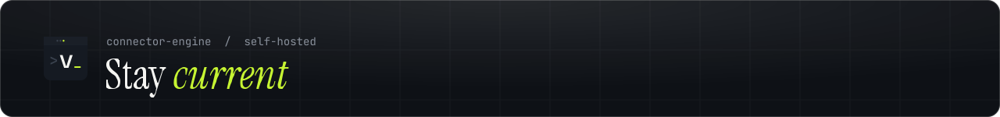

# Updating

Your data lives in volumes, apart from the code, so an update replaces the code and keeps everything you set up. Database migrations run by themselves when the engine starts.

## Docker, from a clone

```sh
mise run export                 # a full backup first, in case you need to go back
git pull
mise run up                     # rebuilds the image and restarts the stack
```

`mise run up` rebuilds with `--build`, then runs `mise run unlock`, which waits until the recreated engine and console confirm they are unlocked ([keychain](keychain.md#how-the-unlock-key-reaches-the-container)), and prints:

```text
console: http://127.0.0.1:7465   agent endpoint: http://127.0.0.1:7465/mcp
```

To pin a version once releases exist, check out its tag instead of `main`: `git checkout v0.1.0`.

## Without Docker

Installed with the installer (available after the first release (v0.1.0)): back up, stop, run the installer again (it replaces the binaries in place), start:

```sh
vsh export
vsh stop
curl -fsSL https://raw.githubusercontent.com/versatile-sh/connector-engine/main/scripts/install.sh | sh
vsh up --open
```

Set `CONNECTOR_ENGINE_VERSION=v0.1.0` to install a given release instead of the latest.

## Going back

1. Check out the previous tag (or reinstall the previous version).
2. Restore the backup you made before updating: `mise run import -- ...`.

A backup from a newer format is refused by an older build, so keep the backup you took before the update.

## Security fixes

Watch the repository's releases. Until 1.0, only the latest minor release gets security fixes ([SECURITY.md](../../SECURITY.md)).
