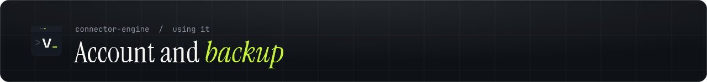

# Account and backup

The console keeps its users and their access keys. This page covers the password, full backups, shareable setups, and restoring either.

> **Your data lives in Docker volumes.** `docker compose down -v`, `docker system prune --volumes` and `docker volume prune -a` delete them, and with them every connector, credential, access key and the root keys. Nothing can bring them back. Export a backup first.

## Account

Account has up to three tabs, each its own address, and shows only those the signed-in user's role opens. With one tab there is no tab bar.

| Tab | Address | Who sees it | Holds |
|---|---|---|---|
| Profile | `/account` | everyone | the username and password |
| People | `/account/people` | Owners and Admins | the people of the console, the join and reset links waiting, and the recent changes |
| Backups | `/account/backups` | Owners, and Admins for setups | full backups (Owners) and shareable setups (Owners and Admins) |

People lists each person with their role, their keys and when they joined, and marks your own row "you". An Owner invites with **Invite someone**: pick a role, then copy the link and send it privately. It works once and expires after 72 hours. When the console's public address is a loopback one, the invite says nobody else can open it; set `CONSOLE_PUBLIC_URL` first. Each row of an Owner holds one menu: another role, **Reset password** and **Remove**, which asks first and names what it does. An Admin gets **Reset password** on Members' rows. An Owner can also turn on **Allow sign-up** above the list, with the role new accounts get (Member by default, or Admin): the sign-in screen then shows **Create account**. Leave it off on any console reachable from the internet. The link opens `/invite`, which asks the invitee for a username and a password, or asks the person whose password is reset for a new one, and says when a link no longer works.

Once a second person exists, the shell shows your role beside Account, and Access, Approvals and Activity offer **Mine | Everyone** to Owners and Admins, with each row then naming its owner. A one-user install looks as before.

- **Profile** changes the signed-in user's username and password. A username is unique without regard to case, and the login finds it the same way. A password change asks for the current one, needs at least 10 characters, signs out that user's other sessions and keeps this one; other users stay signed in.
- Wrong current passwords are rate-limited like the login: 5 a minute.
- A wrong password and an unknown username get the same answer, "wrong username or password", after the same work.
- The console keeps its users in the state file, keyed by the engine person id. The first user is an Owner with the configured `--person` (default `owner`). Removing or demoting the last Owner is refused. Each user acts on the engine as their own person ([engine identity](../self-hosted/person.md#engine-identity)).
- A state file from an earlier console, with its one `owner` account, becomes that Owner on the first start, and its sessions stay signed in. This is a one-way door: once this console writes the file it has no `owner`, and an earlier console on the same volume would see a first run.
- The state file carries a `format` number. An older file (no number) is upgraded step by step on start and written in the current format on its first change. A file with a newer `format` than this console reads is refused with a message that names both numbers and is left untouched, so a rollback never drops fields it does not know; restore a backup or run a newer console.

Forgot the password? On the machine that runs the console:

```sh
make reset-password                          # without Docker: vsh reset-password
make reset-password USER=<username>          # once there are several users; without Docker: --user <username>
```

With one user the name may be left out.

It asks for the new password twice, without echo, then prints:

```text
password changed; every console session of that user is signed out
access keys and apps signed in through the browser still work: revoke them on the Access page if you suspect a compromise
```

It reaches the console through a socket that only `docker compose exec` can open, so access to this machine is the authority. The password travels on stdin, never in argv or the environment.

## Export and import

**Account → Backups → Export** offers two files.

| Mode | File | Holds | For |
|---|---|---|---|
| Full backup, with credentials | `connector-engine-backup-<UTC time>.cebak` | everything: the engine's rows and keys, the console's state, keys and activity | moving or restoring your own install |
| Shareable setup, without credentials | `connector-engine-setup-<UTC time>.setup.yaml` | each connector's source and choices, whether its new keys start off, each key's profile there (received as reusable [permission sets](permissions.md#permission-sets) named after the keys), skills with their pinned digest, the kinds of notification channel | handing your setup to a friend or a teammate |

From the command line:

```sh
make export                  # full backup: asks y/N (YES=1 skips it), then a passphrase of 12+ characters twice
make export MODE=setup       # shareable setup, no credentials
```

```text
wrote /home/you/connector-engine-backups/connector-engine-backup-20261120T180000Z.cebak (the 7 newest backups are kept in /home/you/connector-engine-backups)
```

Without Docker, the same files come from `vsh export` (add `--setup` for a shareable setup), and restore with `vsh import FILE`.

A setup carries **permissions as reusable sets**; a backup carries **your exact keys**.

### Full backups

A full backup holds every credential of the install: provider sign-ins and API keys, the access keys and the root keys, the account and its activity. The console asks you to confirm that, then for your password and a passphrase, twice.

**Keep the passphrase safe.** Nobody can recover it, the maintainers included. Without it the file opens for nobody; with it the file opens for anyone. Store the file like a password manager export, and never share it.

File format:

- One header line, then AES-256-GCM ciphertext.
- The header carries the format version, the Argon2id parameters (3 passes, 64 MiB, 4 lanes), a 16-byte salt, the nonce, and a check value that tells a wrong passphrase from a damaged file. It is authenticated as additional data.
- Inside is a tar archive: a manifest (format, engine build, time, counts, the SHA-256 of every file), the engine's snapshot (`GET /v1/snapshot` on its operator listener), the console's state without sessions, its key store, and its activity files.

### Shareable setups

A setup records each connector's credential mode as `credentials: per_person`; a connector without the field imports as `shared`, so older setups import as before. A setup never holds credentials, tokens, API keys, OAuth clients, access keys (only their names, as the names of permission sets), root keys, account data, activity or device pairings.

- Every address loses its user name and password, its query and its fragment.
- An address whose path holds a token-like segment (20 or more letters, digits, `-` or `_`, with a digit) is left out.
- The file lists each removal under `stripped`, naming only the site.

## Restore

**Account → Backups → Import**, **Restore from a backup** on the first-run screen, or:

```sh
make import FILE=~/connector-engine-backups/connector-engine-backup-20261120T180000Z.cebak
```

Either kind of file works; the console tells them apart by their first bytes.

| File | What happens |
|---|---|
| full backup | checked first (passphrase, integrity, every checksum, the version; a newer format is refused), then you see what it holds and confirm that it **replaces** this install's data |
| setup | shows what it would add, then adds each connector and skill through the normal import; an installed entry keeps its choices, and nothing is deleted. Sign in to each added connector afterwards |

A full restore, step by step:

1. One restore runs at a time. The console stages its keys and activity.
2. The engine stages its keys, replaces its rows in one transaction, checks them before the commit, and puts its keys in place.
3. Only when the engine succeeds does the console put its own files in place.
4. The root keys are wrapped again with this machine's keychain key.
5. The engine and the console restart. `make import` runs `make unlock` for you; from the console, run `make unlock` yourself. Sign in with the restored account's password.

- A refusal before the engine's commit leaves the install as it was.
- The engine refuses a snapshot whose schema is newer than the one of the store kind that wrote it, that holds a table it does not know, a row that does not decode or is there twice, two grants with one key, a grant row its rules refuse, a row stored under another tenant or under the installation, or a binding to a connector the snapshot lacks. Rules that depend on this install's settings, such as `permission.alwaysMaxDuration`, are not applied, so a backup taken before a stricter setting still restores.
- The refusal names the first offending row by its kind and its ids, with the rule it breaks; each value taken from the file is quoted and cut to 64 characters, and no other field of the row appears.
- A grant that names a connector or a function the snapshot lacks is kept, as it can be written today: the restore counts it as a warning and lists the first 20. It never applies until that connector and function exist.
- An applied restore writes one `connector.snapshot.restored` audit row and event on the installation, with who restored it, the rows per kind and the number of warnings. A restore from the console is recorded as the signed-in person, or `make import`'s owner; the first-run restore and a call with the operator token alone are recorded as `system`.
- Importing the same backup again gives the same result. If a disk fails right after the commit, restore the same backup again.
- Signed in, a full import asks for your password again. The first-run restore works only while no user exists.
- A backup from an earlier console, with its one `owner` account, restores: the account becomes the Owner with this console's `--person`. A backup made by this console has `users` and no `owner`, and uses backup format 2, so an earlier console refuses it as written by a newer connector-engine. This is a one-way door: keep the earlier console's own backups if you may go back to it.
- A setup's review shows each new connector's host, whether it is `local` (it reaches a private or loopback address on this machine), whether its new keys start off, and each choice the file sets above what this console proposes. Every choice is capped at this console's proposal, local connectors included, and the result lists what was lowered.
- Keys made already start off on the connectors and skills a setup adds, unless **Give my existing keys the new connectors** is on.
- Per permission set the review chooses **Keep** (the default), **Apply** to an existing key, or **Discard**. A set whose name is taken gets the first free `-2`, `-3` suffix. `make import` takes the defaults: every set kept, existing keys off, choices capped.
- A full backup restores the keys and the sets exactly as they were; it creates none.

## Where state lives

| Volume | Holds |
|---|---|
| `pgdata` | the engine's database: connectors, grants, skills, sealed credentials, audit |
| `engine-data` | the engine's key store: the wrapped root key, the key ring and the local issuer's signing keys |
| `console-data` | the owner account (PBKDF2-SHA256), access keys and agents, OAuth clients, the console's sealed secrets and key store, activity, settings |
| `secrets` | what `init` writes once per install: the operator token and the Postgres passwords; not in a backup, since a new install writes its own |

How the root keys are protected: [the keychain](../self-hosted/keychain.md).
