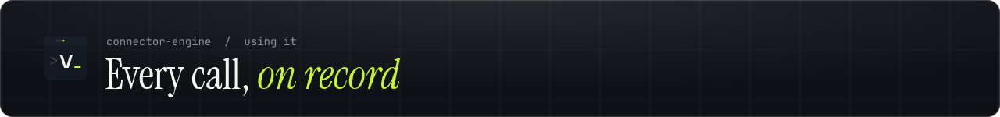

# Activity

The **Activity** page lists every call an AI app made through the console's `/mcp`, per hour and per connector. Open a call to see its arguments and a result excerpt.

## What is recorded

| Item | Default |
|---|---|
| arguments | recorded |
| result excerpt (first 4 KB of each answer) | off; turn on **Record result excerpts** under **What is kept** on the Activity page |
| likely secrets (token, password, secret, authorization, API key, bearer and key-shaped values) | replaced before anything is written |

- Records go to `activity/YYYY-MM-DD.jsonl` beside the console's state file, mode 0600, kept 30 days.
- The engine itself keeps only a hash of the arguments, plus its audit rows and call records (90 days in the `person` profile, `retention.audit` and `retention.calls`).
- **Delete all activity** removes the files and hides older engine call records from the page.

## Headless

The engine publishes every call as a [CloudEvent](../reference/events.md): `connector.call.started`, `finished`, `failed`, `denied` and `outcome_unknown`. Send them to your own store with the `webhook` sink. The operator API lists recent calls:

```sh
cnctl admin calls list
```
