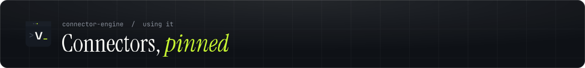

# Connectors

A connector is one tool server behind the gateway. AI apps never reach it directly: every list and every call goes through the engine, which checks permissions, injects the credential and records the call.

## Kinds

| Runtime | Talks to |
|---|---|
| `remote` | an MCP server over HTTP |
| `declarative` | a REST API described by OpenAPI |
| `grpc` | a gRPC service, through reflection or the Buf Schema Registry |
| `skill` | a skill package (files, no server); see [skills](skills.md) |

A connector keeps **one credential** that every access key shares. Keys differ only in permissions ([functions and permissions](permissions.md)).

## Names an app sees

| Item | Listed as |
|---|---|
| function | `<alias>__<name>` |
| prompt | `<alias>__<name>` |
| resource | `<alias>+<uri>` |

The separator (`gateway.separator`, `__`) and the longest name (`gateway.toolNameMax`, 64) are [configuration keys](../reference/config.md).

## Pinning and quarantine

- Each function definition is hashed (RFC 8785 canonical JSON) when it is captured.
- A new function, or a changed description or schema, is **quarantined** until you accept it.
- A permission made against an older hash goes stale and needs confirming again.
- Re-lists run on a schedule (`pinning.relistMin` to `pinning.relistMax`), so a server that changes its tools after install is caught.

In the console, a quarantined function says "The definition changed" on the connector's page; choosing on or ask accepts the current definition. Through the operator API:

```sh
cnctl admin functions accept <connector id> <function name>
```

## Server instructions, prompts and resources

| Item | Setting in the `person` profile | Behaviour |
|---|---|---|
| server instructions | `gateway.relayInstructions: pinned` | kept with the connector, quarantined until accepted and again on change; once on, apps read them in the engine's own instructions |
| prompts | `gateway.upstreamContent: granted` | proposed off, because a prompt's text arrives in the chat as if you wrote it |
| resources | `gateway.upstreamContent: granted` | proposed on |

Each item is off, on or ask like a function, and quarantined on change. The engine default and the `headless` profile refuse all three.

## Remove a connector

**Remove connector** on the connector's page drops it and its permissions. Export a [setup](account-backup.md#export-and-import) first if you may want it back.
